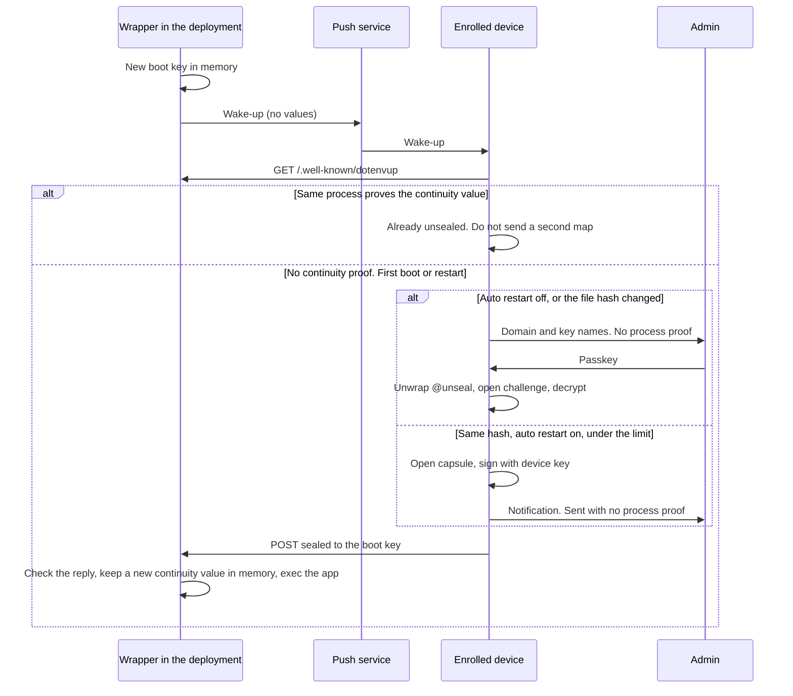

# RFC: Unsealer — production secrets no server can open

> **Status:** Draft RFC, open for review. Not implemented.
> **Format:** [FORMAT_SPEC.md](../FORMAT_SPEC.md) v1, unchanged.
> **Related:** [SECURITY.md](../SECURITY.md), [TEAM_SECRETS_SOLUTION.md](./TEAM_SECRETS_SOLUTION.md), [UNKNOWNPASSWORD_BOUNDARY.md](./UNKNOWNPASSWORD_BOUNDARY.md)

## How to review this RFC

This document is published before any code, so the design can be attacked while it is cheap to change. Review it line by line. Security findings go through [SECURITY.md](../SECURITY.md).

Read in this order: *Summary*, *Threat*, *User experience*, *Protocol*, then *Security claims*. *Decisions* records what is already settled and why. *Open questions* lists what is not.

## Contents

1. [Summary](#1-summary)
2. [Threat](#2-threat)
3. [Goals and non-goals](#3-goals-and-non-goals)
4. [User experience](#4-user-experience)
5. [Concepts and assets](#5-concepts-and-assets)
6. [Protocol](#6-protocol)
7. [Restarts and auto restart](#7-restarts-and-auto-restart)
8. [Clients, unlock, and recovery](#8-clients-unlock-and-recovery)
9. [The wrapper](#9-the-wrapper)
10. [Deploying](#10-deploying)
11. [Agents](#11-agents)
12. [Security claims](#12-security-claims)
13. [Relation to the format](#13-relation-to-the-format)
14. [Decisions](#14-decisions)
15. [Roadmap and validation](#15-roadmap-and-validation)
16. [Open questions](#16-open-questions)
17. [Rejected alternatives](#17-rejected-alternatives)
18. [Backlog: witnessed log](#18-backlog-witnessed-log)

## 1. Summary

A deployment ships `.env.up` from git and boots without secret values. The admin approves the boot in the Unsealer web app, with a passkey (Touch ID, Face ID, Windows Hello, or a security key). The app decrypts locally and sends the env map, encrypted again, to that one process. The process replaces itself with the real app. Nothing of DotEnvUp keeps running.

- **No server can decrypt.** Not the host, not a vendor, not DotEnvUp. The keys live on the admin's own devices: a laptop, a phone, or both.
- **No install required.** The admin runs the web app themselves, as a static page, in a desktop browser. A phone, a browser extension, or a second computer are optional.
- **One line to adopt.** The start command becomes `up unseal -- <command>`.
- **A live process can prove it is the one already unsealed.** It keeps a random value in memory. A hijacker cannot show that value, so the client does not send them a second map.
- **A restart is answered with no proof.** Memory is gone, so neither an honest process nor a hijacker can show the value. The client answers anyway. By default the admin approves. If they turned automatic restart on, the device sends the last approved map and tells them after.
- **Self-contained.** No account and no hosted service. UnknownPassword has no role. A static page and the published libraries are enough.

The target user is a solo developer or a small team shipping from a laptop, often with a coding agent. They are not infrastructure experts. Every step they see uses plain words and fits a small screen.

The design and the code are public. Security rests on keys only.

## 2. Threat

Hosting platforms store customer environment variables and hold the key that opens them. A copy of that store is a copy of the secrets.

The [Railway incident of October 2026](https://blog.railway.com/p/preliminary-report-october-security-incident) is the reference case. An attacker reached build and CI systems, took credentials, queried the database of encrypted variables, and decrypted part of it. The platform held both the ciphertext and the key, so one breach reached many customers at once. CircleCI (January 2023) is a related case: the platform could read customer secrets it stored.

The path into that store is part of the problem. Values are copied from a laptop, a note, or a password manager and pasted into a dashboard, once per service and environment. Each paste leaves another copy.

Unsealer keeps production values out of the platform's store and out of the copy-paste path. A copy of the store, the database, the build cache, or a disk snapshot yields ciphertext.

What it does not stop:

- An attacker who controls the host while the app runs can read that process's memory.
- An attacker who controls the build can ship a changed wrapper. The admin then approves that boot.
- An attacker who answers the public URL on a first boot or a restart has no continuity value, and neither does the honest new process. The client still answers, with no proof: the admin approves, or automatic restart sends. That is the same answer either way.
- An attacker live inside the platform can force that restart. With automatic restart on, the device sends. With it off, the admin decides.

The claim is narrower than "safe from the platform": a bulk, offline, every-customer dump becomes a live, noisy attack on one app at a time, while the attacker is still inside.

## 3. Goals and non-goals

**Goals**

- No server holds a key that opens production values, or the values themselves at rest.
- Adoption in one line, on any stack, with no SDK.
- Usable by people who are not infrastructure experts.
- A coding agent is not a production recipient, and production values are not written into files the agent is given.
- Claims precise enough to test and attack in public.

**Non-goals**

- Hiding a value from the process that uses it, or from code running as the same OS user after decryption.
- Rotation, dynamic credentials, or central audit. Tools such as Vault cover these.
- Serverless and scale-to-zero platforms.
- Several replicas behind one domain, in v1.
- Plaintext in Terraform state, which Terraform controls.
- Classifying which values are credentials.
- A Terraform provider. `up run -- terraform` covers it (see *Terraform*).

## 4. User experience

**Setup, once per project**

1. `up unseal init` opens the Unsealer web app and waits.
2. In the web app, on the admin's laptop or phone, the user registers a passkey and allows notifications. The app creates the `@unseal` and `@recovery` identities on that device. The hosting platform never sees them. A machine that runs coding agents can hold the wrapped key; it cannot unwrap it without the passkey.
3. The app shows the recovery kit: 24 words and a QR code. The user prints or writes it down.
4. The app hands the two public keys back to the CLI. The CLI adds them to `.dotenvup.recipients.json`, encrypts `.env.up` for them, and asks the user to confirm which keys go to production.
5. `up unseal init` detects the platform and prints the one line to change: the Procfile entry, the start command field, or the Dockerfile `CMD`.
6. The user commits `.env.up`, `.dotenvup.recipients.json`, and `.dotenvup/`.
7. Optional: enroll a phone or another computer, or install the browser extension.

The hand-off in step 4 is a copy-paste of two public keys, or a local file the web app writes where the browser allows it. Public keys are not secret, so either is fine.

**Each deploy**

1. A browser notification, or a line in the `up` output: *"app.example.com is waiting for its secrets."*
2. The user opens it and sees *"Matches the version you saved on 20 Oct. Same 12 secrets."* or *"Changed: 1 new (STRIPE_KEY), 1 removed (OLD_API_KEY)."*
3. A passkey touch. The app starts.
4. Once per app, on a device allowed to: *"Restart this app automatically? You'll be notified each time."*

**Each restart is answered with no proof of the process.** With auto restart off, the admin approves, the same as a deploy. With auto restart on, the device sends and then says *"app.example.com restarted at 03:12. Secrets sent. Stop auto restart?"*

**Messages use these words, not protocol terms**

| Situation | The user reads |
|---|---|
| Nothing changed | Same secrets as last time. Approve? |
| Key names changed | These secrets changed since your last approval: … |
| No signed record for this file | This file wasn't saved from one of your devices. Check the secrets below before approving |
| File is not for this identity | This app's secrets were made for a different key. Nothing was sent |
| App unreachable | Can't reach app.example.com. Is it a worker or private service? |
| App already running | app.example.com is already running. Nothing to do |
| Boot changed while approving | The app restarted. Check again before approving |
| Too many restarts | app.example.com restarted 4 times this hour. Approve this one yourself |
| App sleeps when idle | Your app sleeps when idle. Every wake-up would need your approval. Turn off sleeping first |
| Auto restart on a coding machine | This computer runs coding agents. They could read restart copies of your secrets. Use another device for auto restart |

## 5. Concepts and assets

**Identities**

- **`@unseal`**: the recipient of production `.env.up` files. Its private key is wrapped by a passkey and opened only during an approval.
- **`@recovery`**: a second recipient, printed as the recovery kit. Never boots an app. Used to reseal after losing every device.

**Devices**

- **Enrolled device**: any browser, extension, or phone where the web app is set up with the passkey. All are equal. None is required.
- **Coding machine**: a device that runs coding agents. It can approve, but holds no restart material. The default answer to "Does this computer run coding agents?" is yes.
- **Device key**: a signing key on a device allowed to auto restart. Its public half is committed in `.dotenvup/devices`.

**Files in the repo**

- `.env.up`: the production file, encrypted for `@unseal` and `@recovery`. `@unseal` is the primary recipient, so `Key-Id` names it.
- `.dotenvup.recipients.json`: the existing recipients file. It maps `@unseal` and `@recovery` to their public keys, like any other recipient.
- `.dotenvup/devices`: the passkey public key, for checking approval records, and the device public keys allowed to auto restart.
- `.dotenvup/approvals`: signed approval records.

The repo-level `.dotenvup/` directory is new. It is not `~/.dotenvup/`, where a developer's own identity lives.

**Per boot**

- **Boot key**: a fresh X25519 keypair in the wrapper's memory. The map is sealed to it.
- **Restart capsule**: an approved map, encrypted on a device for unattended restarts of that same file.
- **Approval record**: a signed line in `.dotenvup/approvals` saying which file hash and key names the admin saved.

| Asset | Where it lives | Opens values |
|---|---|---|
| `.dotenvup.recipients.json` (`@unseal` and `@recovery` public keys) | Repo and image | No |
| Wrapped `@unseal` private key | Enrolled devices, wrapped by the passkey | After a passkey touch |
| Unwrapped `@unseal` private key | Client memory, during one approval | Every file for the key |
| `@recovery` private key | Recovery kit, offline | Every file for the key |
| `.dotenvup/devices` | Repo and image. Passkey and device public keys | No |
| `.dotenvup/approvals` | Repo. Signed records: file hash, key names, time | No |
| Device key, private half | That device. Usable without a passkey touch | No. Signs auto restarts |
| Restart capsule and capsule key | That device. Usable without a passkey touch | That app's last approved map |
| Boot key, private half | Wrapper memory, one boot. Never written | That boot's POST |
| Continuity value | The process that was unsealed, in memory only | Nothing. It only proves that this is still that process |
| Push subscription and VAPID key | Hosting variables | No. Can only wake a device |
| `.env.up` | Repo and image. Ciphertext | No |
| Env map | The app process, after approval | That app |

Production files have two recipients, `@unseal` and `@recovery`, and no `[policy]` section. The laptop identity is not a recipient. Dev and CI files keep their own recipients and may use `[policy]`.

## 6. Protocol

### 6.1 Discovery

While sealed, the deployment serves:

```text
https://app.example.com/.well-known/dotenvup
```

It answers with `Access-Control-Allow-Origin: *` and accepts no cookies or credentials. GET is public. POST carries only ciphertext.

### 6.2 Waiting record (GET)

| Field | Purpose |
|---|---|
| `Key-Id` | Which `@unseal` identity the file is for |
| `.env.up` | The file itself. Ciphertext plus the cleartext key names it already carries |
| File hash | BLAKE2b of the file. The client recomputes it |
| Boot public key | Where the map will be sealed |
| Nonce | Single use, for this boot |
| Challenge | A random value sealed to the `@unseal` public key |

The record carries the whole file, so the client needs nothing else from the host. v1 files do not include recipient public keys, so the image also carries `.dotenvup.recipients.json`, which the wrapper reads to seal the challenge.

### 6.3 Reply (POST)

One sealed box to the boot public key, containing the map plus a proof:

- **Passkey path:** the opened challenge. Only a holder of `@unseal` can open it.
- **Auto path:** a signature by a device key over the domain, nonce, boot public key, and file hash. The wrapper accepts only keys listed in `.dotenvup/devices` in its image.

Either proof stops anyone else from filling a sealed app with their own values, such as a `DATABASE_URL` that points at them. Sealing to the boot key hides the map from a passive reader on the path, when the honest process created that key. It does not hide the map from whoever is answering the GET: that party chose the key and can open the POST. The continuity value in the next section is what stops that party while the real process is still alive.

### 6.4 Flow



### 6.5 Approval records

When an enrolled device saves a changed `.env.up`, it appends a record to `.dotenvup/approvals`: file hash, key names, time, and device. The record is signed with a WebAuthn assertion from the passkey, so writing one needs a touch. A coding agent cannot forge it.

At boot, the client compares the deployed file hash with the records:

- **Match:** *"Matches the version you saved on 20 Oct."*
- **No match:** *"This file wasn't saved from one of your devices,"* followed by the key-name diff against the last record.

Records are signed, not sealed. Key names are already visible in a v1 file, so sealing would hide nothing, and anyone can seal to a public key. A signature is what stops a forged record.

One passkey touch covers both jobs. A single `navigator.credentials.get` call returns the PRF output that unwraps `@unseal` and an assertion over the WebAuthn challenge; the client sets that challenge to the record hash. The passkey public key is committed in `.dotenvup/devices`, so any device can check a record.

Records live in the repo so every device sees the same history and git shows when it changed. Only the web app can sign a record. Where the browser allows it, the web app writes the file into the local checkout; elsewhere the user downloads it and `up unseal record <file>` commits it. The CLI never signs.

### 6.6 Boot key and the continuity value

Each boot makes a new X25519 keypair in memory. It is never written to disk, a hosting variable, a log, or the waiting record. A restart makes a new one. The map is sealed to it so a passive reader on the path cannot open the POST.

That key does not name the process. Whoever serves the GET chose it.

After a successful unseal the process keeps a random continuity value in its memory, and the client keeps only the verifier (a hash or a public key). A later request from that same process proves the value. The client treats that as the process it already unsealed and does not send a second map.

The value is not a key. It does not open `.env.up`, a capsule, or `@unseal`. It is not derived from them. It is not written to disk, a hosting variable, a log, or the image. A reader on the host can already read the running process; that is outside this proof. A remote hijacker cannot show the value, so the client does not treat them as the process already running.

A first boot has no value. A restart destroys it. In both cases the client answers with no continuity proof. By default the admin looks at the domain and the key names and approves. If automatic restart is on, and the file hash is unchanged, the device sends the last approved map and notifies the admin. See *Restarts and auto restart*.

Nothing stored on the platform would tell the honest restart from a hijacker, because the platform attacker can read it. The protocol does not wait for a proof that cannot exist. Missing proof is the restart case, and it is answered.

### 6.7 Sealed mode

The wrapper listens on `$PORT` until a valid POST arrives. It serves only:

| Request | Answer |
|---|---|
| `GET /.well-known/dotenvup` | 200, the waiting record |
| `POST /.well-known/dotenvup` | 204 on success. 400 on a bad proof. The body cap must fit one sealed map for that deployment |
| `OPTIONS /.well-known/dotenvup` | The CORS answer |
| `GET` on the app's health path | 200, so the platform keeps the instance |
| Anything else | 503 with a plain "starting" page |

After a valid POST, the wrapper closes the socket, sets the environment, and execs the app in the same process. The app binds `$PORT` and serves its own health path as it always did.

The health path is the one the platform already checks, such as `/health`. `up unseal init` reads it from the platform config where it can, and `--health-path` sets it by hand. The health check must not point at `/.well-known/dotenvup`: after the exec, the app does not serve that path.

Many platforms route traffic to a new instance only after its health check passes, and the client reaches the app through that same domain. So the sealed instance must look healthy. The cost: from the traffic switch until approval, users see the "starting" page. With auto restart that is seconds.

The wrapper waits as long as the platform lets it. It has no timeout of its own. If the platform kills a sealed instance, the next boot starts over with a new boot key.

If `UP_KEY` or `DOTENVUP_PRIVATE_KEY` is set and its public key matches `@unseal`, the wrapper refuses to start and says why. That variable would let the host open every production file.

Each POST fills the process that served it. Several sealed replicas behind one domain make the GET ambiguous; that case is out of v1.

## 7. Restarts and auto restart

### 7.1 The trade-off

Every restart wipes the continuity value. The new process cannot prove it is the one the admin unsealed, and a hijacker cannot prove otherwise. The client answers the restart with no proof. That is the design, not a fallback.

Two answers, both without a process proof:

- **Admin approval**, the default. The admin sees the domain and the key names and approves with the passkey.
- **Automatic restart**, off until the admin turns it on for that app. The device sends the last approved map for an unchanged file and notifies the admin afterwards. The admin is choosing not to be woken, and accepting that whoever answers the domain receives that map. The capsule on the device is what makes that send possible. It is not a proof of the process.

| Restart | What happens |
|---|---|
| A deploy, or a changed file hash | Passkey approval |
| Same hash, auto restart off | Passkey approval |
| Same hash, auto restart on, under the limit | An enrolled device answers and notifies |
| Same hash, over the limit | Passkey approval |
| No enrolled device awake and online | The app waits |

The wrapper does not supervise. An app crash ends the container, and the platform restarts it like any other restart.

### 7.2 Capsules and device keys

At a passkey approval, a device allowed to auto restart encrypts that app's map under its capsule key, bound to domain, `Key-Id`, and file hash. A new approval replaces it. Turning auto restart off deletes it.

The capsule key and the device key must work without a passkey touch, or nothing could answer unattended. They are weaker than the passkey. That is why the auto path holds approved maps only, never `@unseal`. It cannot open a new file, git history, or another app's file, and cannot reseal.

Enrolling a device for auto restart adds its public key to `.dotenvup/devices`. It takes effect at the next deploy. Removing the line and deploying revokes it.

| Device | Capsule and device keys | Who else can use them |
|---|---|---|
| Desktop browser or extension | WebCrypto non-extractable keys in the browser profile | Any process running as the same OS user |
| Phone home-screen web app | WebCrypto non-extractable keys in the phone's app sandbox | Code running on that unlocked phone |
| Native phone app (later) | Secure Enclave or StrongBox | Code on that phone, through the keystore only |

### 7.3 Coding machines

A coding agent runs as the developer's OS user. It can read the browser profile, and so any capsule or device key there. So a coding machine never holds restart material. It can still approve everything: the bundle is wrapped by the passkey, and an agent cannot touch the passkey.

A laptop that runs coding agents can approve with the passkey. It does not hold a capsule or a device key, so it cannot answer a restart by itself. A phone, or another device that does not run coding agents, is where auto restart lives if the admin turns it on.

### 7.4 Policy on the device

- Same domain, `Key-Id`, and file hash as the capsule.
- A rate limit per app, counted on each device. Default: 3 auto restarts per hour, then passkey approval. Devices share no live state, so with *k* devices allowed to auto restart an attacker forcing restarts gets up to 3*k* maps per hour, each one notified. Most setups have one such device.
- A notification on every enrolled device after every auto restart, with one tap to stop it.
- Any enrolled device may answer. The nonce is single-use, so the first answer wins.

### 7.5 Waking a device

A browser accepts no connections, so the wrapper wakes it with Web Push. The push subscription and VAPID key sit in hosting variables. A leak lets someone send wake-ups, which the device checks and may refuse. A push carries no values and cannot approve. Without push, the `up` CLI prints the waiting domain and the user opens it.

| | Desktop browser or extension | Phone home-screen web app | Native phone app (later, optional) |
|---|---|---|---|
| Push sender | The wrapper | The wrapper | A relay the admin runs, if they build a native app. It cannot decrypt |
| Background delivery | While the browser runs. An extension needs no open tab | Unknown on iOS. Needs a spike | Notification Service Extension |

## 8. Clients, unlock, and recovery

### 8.1 Clients

The client holds the unwrapped key during an approval, so its code is the most sensitive code in the system.

| Client | Role |
|---|---|
| Unsealer web app, desktop browser | The default. Every feature works here |
| Same app on a phone home screen | Optional. Awake when the laptop is not |
| Browser extension | Optional. Wake-ups with no tab open |
| `up unseal` CLI | Setup, platform detection, printing waiting domains, committing records the web app signed |
| Native phone app | Later, optional, never required |
| VS Code extension | Not a client. It runs next to the coding agent |

The client keeps a local list of app domains, so the admin does not paste them. A list only names domains: it holds no key, and the client always shows the domain before approval.

**Hosting the web app.** The open-source client is a static page the admin hosts. There is no official origin, and this design does not put the client on dotenvup.com. A page on someone else's origin would see the unwrapped key during an approval. That is a separate product decision, outside this protocol.

The build is versioned and reproducible, with Subresource Integrity and a published build hash. Updates are explicit, never silent. Choose the origin before enrolling, because passkeys belong to an origin: moving later costs one recovery-kit step per identity. The deployment never serves the client.

### 8.2 Unlock

The `@unseal` private key is wrapped with a key from the WebAuthn PRF extension. Unlock is a passkey prompt; there is no passphrase to choose or forget. The wrapped bundle is safe to copy, because opening it needs the passkey.

For a client without PRF, a passphrase fallback uses the existing key bundle format (`packages/format/src/keyBundle.ts`), with scrypt `N` raised from 2^15 to at least 2^17 and a browser implementation, since `keyBundle.ts` imports `node:crypto` today.

### 8.3 Recovery kit

`@recovery` is a separate recipient. Its private key is shown once as 24 words with a checksum (BIP39-style) and a QR code of the same key. It never boots an app. After losing every device or passkey, it opens the files so they can be resealed to a new `@unseal`.

This is not the existing `up key recovery` bundle, which backs up a developer's own identity in `~/.dotenvup/`. The two are separate keys for separate jobs. The documentation must keep the names apart.

### 8.4 Editing and resealing

Editing a value means decrypt, change, and encrypt again for `@unseal` and `@recovery`, in a short web app session, not on a coding machine. The web app is the only place that can open a production file, so it reads and writes `.env.up` itself: through the browser's file access where available, or by upload and download with `up unseal record` to commit the result. The device appends an approval record. The new file has a new hash, so the next deploy asks for a passkey approval and writes a new capsule.

A value can be added without opening the file only if the client re-encrypts the whole payload, which v1 files require. So every edit is a decrypt. That is why editing happens in the web app and never in the CLI.

Resealing retires an identity: every file is re-encrypted for a new public key, capsules are dropped, and every copy of the old bundle is destroyed once the new files work. Git history stays sealed to the old key and stays confidential only if that key was never copied.

## 9. The wrapper

The start command becomes:

```text
up unseal -- npm start
```

The wrapper serves sealed mode, checks the proof, opens the reply with the boot key, and execs the command with the map in its environment. Application code keeps reading `process.env` or `os.environ`. Signals, health checks, process managers, and restart policies see the app, not DotEnvUp.

It is a small TypeScript program. It uses `@dotenvup/format` to seal the challenge and hash the file, so there is one implementation of the cipher. It does not decrypt `.env.up`. It reads `.dotenvup.recipients.json` for the `@unseal` public key, `.dotenvup/devices` for device keys, and the `Encrypted-For` header to confirm the file is for `@unseal`. A file whose recipients do not include `@unseal` is refused: that is a dev or CI file, and `up run` is its path. The production image needs Node to run it. A static binary in another language is not part of this version.

Hosting variables: none for a decryption key. The only new ones are the push subscription and VAPID key, which open nothing. The image contains `.env.up`, `.dotenvup.recipients.json`, and `.dotenvup/`, never a private key.

`@dotenvup/node` `config()` keeps decrypting with `UP_KEY` for dev and CI files. It must refuse a file whose `Encrypted-For` includes `@unseal`, with a message that names this RFC.

## 10. Deploying

### 10.1 Platforms

Every platform lets the user set the start command. What decides the fit is how often the platform restarts instances, how many run, and whether a sealed instance is reachable.

| Platform | Restarts on its own | Instances | Reachable while sealed | Fit |
|---|---|---|---|---|
| Classic VM (EC2, Droplet, Hetzner; systemd or Compose behind nginx or Caddy) | Reboot, deploy | One, usually | Yes, through the proxy | Best |
| Railway, Render (paid), DigitalOcean App Platform, Koyeb | Deploy, maintenance | One by default | Yes, with the platform health check on the app's own health path | Good |
| Fly.io | Host migrations. Auto-stop is often on | Often two or more | Through the load-balancing proxy | With auto-stop off and one machine |
| Heroku | Every dyno at least daily | One or more | Yes | Good with auto restart |
| Scale-to-zero (Render free, Railway app sleeping, Fly auto-stop) | Every wake-up | Zero or one | — | No. `up unseal init` refuses |
| Cloud Run, App Runner, Azure Container Apps | Scale to zero by default | Autoscaled | Through a load balancer | v1.1, with min = max = 1 and the CLI relay |
| ECS or Fargate, Kubernetes | Task replacement, rescheduling | Often two or more | Private addresses; readiness gates traffic | v1.1, one replica, CLI relay |
| Lambda, Vercel, Netlify, Workers | Every invocation | — | — | Out of scope |

Restart cadences are from memory and must be checked against current platform documentation before release.

On a classic VM the usual leak is a plaintext `.env` on disk, copied by snapshots, backups, and images. Unsealer removes that file. The reverse proxy must forward `/.well-known/dotenvup` to the app; some certbot setups send all of `/.well-known/` to a static directory. The docs ship nginx and Caddy snippets.

### 10.2 Servers the client cannot reach

| Server type | Why |
|---|---|
| Background worker, queue consumer, cron | No HTTP ingress |
| Private service | No public domain |
| Behind an auth gateway, WAF, IP allowlist, or mTLS | The client is blocked |
| Path-prefixed or shared domain | Not at a host root |

v1 says *"Can't reach app.example.com"* and does not guess. v1.1 adds the CLI relay and the mailbox (see *Agents*), which cover these cases with the same sealed reply.

**CLI relay (v1.1).** `up unseal --via <tunnel>` forwards the waiting record and the sealed reply over a tunnel the admin already has: `kubectl port-forward`, `fly proxy`, `gcloud run services proxy`, AWS SSM, or `ssh -L`. The tunnel sees ciphertext. Approval still happens in the client.

### 10.3 Terraform

DotEnvUp does not compete with Terraform. Terraform receives the decrypted values and works as usual; DotEnvUp fixes how they reach it, with no copy-paste and no plaintext `terraform.tfvars`.

Terraform reads `TF_VAR_<name>` environment variables, so this works today:

```text
up run -- terraform apply
```

The infrastructure file holds keys such as `TF_VAR_db_password`, declared `sensitive = true` in Terraform. A later flag, `up run --prefix TF_VAR_ --`, would avoid renaming keys.

| Where Terraform runs | Recipient |
|---|---|
| CI | `@ci`, or (v1.1) the mailbox with an OIDC rule |
| An admin machine without coding agents | A dedicated `@infra` identity |
| A coding laptop | Dev and staging values only |

Terraform state holds plaintext, and a resource that writes a secret into a platform's env vars puts it back in the store this RFC avoids. So:

1. **Terraform provisions, Unsealer delivers (recommended).** Terraform creates the service and the start command and sets only variables that open nothing. Runtime values never pass through Terraform.
2. **Terraform writes the secrets.** Values come from `.env.up` instead of copy-paste, then sit in state and the platform store as before. Delivery improves; storage does not.

## 11. Agents

### 11.1 Coding agents on the laptop

[SECURITY.md](../SECURITY.md) already says a same-user process can read injected secrets. Unsealer does not hide a value from an agent that shares a user with the process holding it. Production stays closed because the agent is not a recipient, cannot touch the passkey, and finds no restart material on a coding machine.

| Secret | Agent on the coding machine sees |
|---|---|
| Production `.env.up` | Ciphertext and key names |
| Dev `.env.up` for the laptop identity | The values, so ordinary work never waits for approval |
| The wrapped bundle | Ciphertext |
| Capsules and device keys | Nothing. They are never on a coding machine |

The harness that deploys stops at deploy. It does not run as the app user after approval.

### 11.2 Server agents (v1.1)

Agents that run on servers keep secrets too, usually in the vendor's store, which holds the secrets and the key. Agent environments are full of AI provider keys, which is what the Railway attacker went for.

| Kind | Examples | Path |
|---|---|---|
| Long-running agent server | OpenClaw Gateway, n8n, a self-hosted agent or MCP server | `up unseal -- <server>`, plus the egress proxy |
| Cloud coding agent | Hosted Claude Code, Codex, Cursor, Copilot coding agent, Devin | Mailbox with a pairing link |
| CI | GitHub Actions and similar | Mailbox with OIDC auto-approval |
| Worker or private service | Queue consumer, cron, internal API | Mailbox with a pairing link or OIDC |
| AI app builder that also hosts | Replit, Lovable, Bolt, v0 | Only if the platform implements this protocol |

Rules for every agent:

1. **No production.** Agents get `@agent` or `@ci` files, usually dev or staging `[policy]` slices. The client never offers an `@unseal` file to a session marked agent or CI.
2. **Session lifetime.** The map lives in that VM's memory for that task. Nothing stays in the vendor's store, not even `UP_KEY`.
3. **Prompt injection remains.** An agent tricked into printing its environment prints what it holds. Narrow slices and the egress proxy limit that.

**Mailbox.** A VM with no ingress dials out: `up unseal --mailbox <url> -- <command>`. The wrapper puts its waiting record in the mailbox under `id = hash(boot public key)`. The client fetches it, checks the key against `id`, asks for approval, and leaves the reply sealed to the boot key. Records expire after 10 minutes. The size cap must fit one waiting record for that deployment. Anyone can run a mailbox. A hacked one gets ciphertext and cannot swap keys, because `id` reaches the client from the pairing link or the OIDC token, never from the mailbox alone. The mailbox URL may sit in a hosting variable; it opens nothing.

**Pairing link.** For sessions a human watches, the wrapper prints:

```text
Waiting for secrets. Open on a device you trust:
https://<unsealer web app>/#pair=<mailbox url>,<id>
Check words: tiger lamp ocean violin
```

The link is in the URL fragment, carries no secret, and names the exact boot key. Unlike a one-time URL in a deploy log, it proves which key will receive the map. An attacker who can change the session output is already inside the VM that receives it.

**OIDC auto-approval.** For CI, where nobody watches. The wrapper requests a workload identity token (GitHub Actions, Google Cloud, Kubernetes, Fly.io, and others) with audience `dotenvup:<id>`, which binds it to the boot key. An always-on enrolled device checks the signature, audience, and its rules, and answers from a capsule. A rule is made at a passkey approval: *"acme/shop, workflow test.yml, branch main, may receive ci.env.up at hash X."* Answers are rate-limited and may be grouped in a daily digest. The issuer can mint tokens, so a live attacker at the issuer receives that rule's slice; a dump of anything does not. Issuers that cannot carry `id` in the audience are not supported. CI waits while no always-on device is online; `UP_KEY` in the CI store stays available for teams that accept it.

**Egress proxy.** In `up unseal --proxy -- <agent command>`, the agent gets placeholders such as `OPENAI_API_KEY=dotenvup:OPENAI_API_KEY` and base URLs pointing at a proxy. The proxy holds the map, runs as a different OS user or in a sidecar, and adds each key only to requests for its bound hosts. A prompt-injected agent can use a key against its bound host but cannot read it or send it elsewhere. Base-URL mode needs no TLS interception. The proxy is the one DotEnvUp process that keeps running, and it is meant for agent servers only.

**App builders.** A platform that builds and hosts with its own agent holds secrets where that agent runs. The path is adoption: the well-known endpoint and the mailbox are an open integration spec.

## 12. Security claims

### 12.1 Invariants

These are the claims to attack.

1. No server holds the unseal key, a capsule key, a device key, or an env map at rest. This includes the deployment, the platform edge, the push service, any mailbox, and any DotEnvUp-run service.
2. The deployment never holds a key that can decrypt `.env.up` or a capsule.
3. The client opens `.env.up` only after a passkey approval of that file hash.
4. The auto path never touches `@unseal`. It sends only a capsule made at a passkey approval, for the same domain, `Key-Id`, and file hash. It does not prove which process will receive it.
5. The map leaves the client only sealed to that boot's key. Whoever chose that key can open it.
6. A request that proves the continuity value is the process already unsealed, and the client does not send a second map. A first boot or a restart has no such proof and is still answered, by a passkey or by automatic restart. The value opens nothing and is not stored.
7. The wrapper accepts a reply only with the opened challenge or a signature by a key listed in its image's `.dotenvup/devices`.
8. Every unattended answer is recorded, shown on every enrolled device, and counted against its rate limit.
9. Approval records are signed by a passkey assertion. Records never contain values.
10. The app does not write the map into the hosting secret store.
11. A coding agent is not a production recipient, cannot touch the passkey, and finds no capsule or device key on a coding machine.
12. After the wrapper execs the app, no DotEnvUp code runs in the deployment, except the continuity value kept in that process's memory. The opt-in egress proxy is the other exception.
13. No client type is required. The web app in a desktop browser supports every feature.
14. Reseal needs `@unseal` or `@recovery`.
15. (v1.1) A mailbox stores only waiting records and sealed replies, and cannot change the receiving key.
16. (v1.1) The client never offers an `@unseal` file to a session marked agent or CI.
17. (v1.1) In proxy mode the agent receives placeholders, and each key goes only to its bound hosts.

### 12.2 What counts as a break

| Attacker has | Must not get |
|---|---|
| The full hosting secret store, image, build cache, logs, disk snapshots | Any value |
| A network position that only forwards | Any value. The honest process chose the boot key |
| A hijacker answering the URL while the unsealed process is alive and can still prove the value | A second map. The client does not send one |
| A hijacker answering the URL on a first boot or a restart | An answer different from the honest restart. Both are answered with no proof. **Known limit** |
| The push service, or the VAPID key and subscription | Any value. At most, wake-ups the device may refuse |
| A mailbox, as operator | Any value, or a reply sealed to a key it chose |
| The ability to rewrite `.dotenvup/approvals` | A record the client shows as signed |
| A coding agent on the admin's laptop | The production file at rest. While an approval is open in a browser on that same user, the agent can read the browser. **Known limit** |
| A stolen locked device | `@unseal`. Its device key can still auto-answer restarts of approved files until it is removed from `.dotenvup/devices` and deployed. **Known limit** |
| `@recovery` without any copy of `.env.up` | Nothing. Git is a copy, so the kit plus the repo opens every file sealed to that key |
| A prompt-injected agent in proxy mode | A proxied key's value, or its use against an unbound host |
| A live foothold inside the platform | More than the one app the admin approves, or that auto restart is willing to send. **Known limit, not a break** |
| The OIDC token issuer | Beyond the slices its rules allow. **Known limit, not a break** |

A break is any path that gets a value, `@unseal`, or a capsule or device key beyond what its row allows; any way to make the auto path answer without a notification, past the limit, or for a different hash or domain; or any way to fill a sealed app without a valid proof. The *Threat* limits and *Non-goals* are known and welcome as design discussion, not as vulnerabilities.

### 12.3 Failure modes

| Event | Outcome |
|---|---|
| Every device asleep or offline | Restarts wait |
| Device lost, passkey synced | Unlock on another device. Capsules rebuild at the next approval |
| Device stolen | Remove its key from `.dotenvup/devices` and deploy. Until then it could auto-answer restarts of approved files |
| Every device and passkey lost | Recovery kit, then reseal |
| Bundle and kit both destroyed | Cannot boot or reseal. Running processes keep their maps until they exit |
| Hosting secret store copied | Ciphertext, a push subscription, a VAPID key. No values |
| Substitute `.env.up` | Different hash. Auto restart refuses. No signed record. The client shows the diff and asks |
| `@unseal` placed in a hosting variable | That host could open every file for the key. The wrapper refuses to start |
| Attacker answers the URL while the process is alive and proves the value | No second map |
| Attacker answers the URL on a first boot or a restart | Answered with no proof. The admin approves, or automatic restart sends |
| Attacker forces restarts, auto restart off | The app waits for a passkey |
| Attacker forces restarts, auto restart on | One map per restart, notified, then the limit |
| Push service down | Wake-ups fail. The CLI prints the waiting domain |
| (v1.1) Mailbox down, or swaps the key | Sessions wait. A swapped key fails the `id` check |
| (v1.1) OIDC issuer compromised | Matching rules release their slices. Production is never a rule's slice |

## 13. Relation to the format

The file stays `#!dotenvup v1`. This RFC is a boot protocol, not a format version. Approval, one-shot delivery, and "do not write hosting variables" live here, not as fields in `.env.up`.

| Need | Where v1 already covers it | Result |
|---|---|---|
| Service and backup recipients | §4.2 `@service`, §4.4 machine users, §4 multi-recipient | `@unseal` and `@recovery` |
| Names visible before approval | §2.5, §5.3 | The client shows names, never values |
| Identity check | §3.3 `Key-Id` | Mismatch rejects before approval |
| Anyone may seal to a public key | §3.1 `crypto_box_seal` | Approval records are signed, not sealed |
| Ciphertext tampering | §5.2 Poly1305 | Unchanged |

[FORMAT_V2.md](./FORMAT_V2.md) proposes signing the cleartext header and `[keys]` with a key bound to `Key-Id`. Approval records do a narrower version of that job at the protocol layer: they say which file hash a human saved. If v2 ships, a record can carry the v2 signature and the client can show both.

**Errata, applied in [FORMAT_SPEC.md](../FORMAT_SPEC.md):** §5.2 no longer claims forward secrecy. `crypto_box_seal_open` uses the recipient's long-term private key, so that key opens every file ever sealed to it, including git history. §4.4 step 4 is an example for a CI recipient, not a rule that a production key belongs in a hosting variable.

## 14. Decisions

| Decision | Choice | Why |
|---|---|---|
| Main client | Web app in a desktop browser; phone and extension optional | Open source cannot depend on a mobile install |
| Approval | Passkey via WebAuthn PRF; passphrase fallback | Nothing to choose or forget |
| Where `@unseal` is born | On the admin's device, laptop or phone, inside the web app | The host never sees it. A coding agent on that device still cannot unwrap it without the passkey |
| Public keys | In the existing `.dotenvup.recipients.json` | No new file; the wrapper and the CLI already know it |
| Health check | The app's own health path, served 200 by the wrapper while sealed | After the exec only the app answers; a check on the well-known path would fail |
| Restarts | Answered with no process proof. Passkey by default. Automatic restart is opt-in | A restart cannot show the continuity value. The client answers anyway. The capsule is how an admin chooses not to be woken |
| Auto-path proof | Device keys committed in `.dotenvup/devices` | Hosting variables are the store we distrust |
| Coding machines | Approve, but never hold restart material | Agents can read the browser profile |
| Delivery to the process | Exec wrapper in the start command | One line, any stack, nothing left running. A resident supervisor fights process managers |
| Wrapper language | TypeScript, calling `@dotenvup/format` | One cipher. The image needs Node. A Go rewrite of the system is rejected |
| Map transport | Sealed to a per-boot key | Hides the map from a forwarder. It does not identify the process |
| Process continuity | A random value in the memory of the unsealed process | Names the process that is still running. A restart has none, and is answered without it. Not a key |
| Approval history | Signed records in the repo | Shared across devices, visible in git, unforgeable without a passkey |
| Recovery | `@recovery` recipient, 24 words and QR | Independent of every device |
| Web app origin | The admin's own static host | Passkeys bind to an origin. This protocol has no official hosted client |
| UnknownPassword | No role in the protocol | The protocol must stand alone |
| Replicas | Out of v1 | Single-instance first |
| Terraform | `up run -- terraform` with `TF_VAR_` keys; no provider | A provider adds nothing over `TF_VAR_` |

## 15. Roadmap and validation

| Phase | Scope |
|---|---|
| Now | FORMAT_SPEC errata. Terraform documentation for `up run` |
| v1 | TypeScript wrapper, sealed mode, waiting record and sealed reply, continuity value. Web app the admin hosts: identity creation, passkey unlock, recovery kit, approval, editing. Approval records. Web Push. `up unseal init` with platform detection, `up unseal record`. Auto restart with capsules and device keys, off unless the admin turns it on |
| v1.1 | Mailbox, pairing link, OIDC auto-approval, egress proxy, CLI relay, browser extension |
| Later | Replicas, sibling fan-out, build provenance, native phone app, `up run --prefix` |
| Backlog, not scheduled | Witnessed log. See [Backlog: witnessed log](#18-backlog-witnessed-log). No implementation in this RFC |

**Validation before calling it production-ready**

- **Now and in v1:** test vectors for the waiting record, reply, capsule, and approval record in the TypeScript libraries; fuzzing of the well-known endpoint and, later, the mailbox; GitHub private vulnerability reporting.
- **Public canary:** a live sealed deployment holding a canary value. Reading it without an enrolled device is a break.
- **Before 1.0:** a funded third-party audit with a narrow scope (protocol, client crypto, wrapper), sought through programs such as NLnet NGI Zero or OSTIF.

## 16. Open questions

1. **Background push.** Can the extension, and a home-screen web app on iOS, reliably GET, sign, and POST on a push with no tab open?
2. **Approval record format.** The exact encoding of a WebAuthn assertion over a record, and verifying it in the client. Also how the web app reads and writes repo files on browsers without the File System Access API (Safari, Firefox): download plus `up unseal record`, or a small local helper.
3. **Zero-downtime deploys.** Which platforms give each deployment its own URL, so the client can unseal before traffic switches.
4. **Platform facts.** Restart cadences, sleep defaults, health-check paths and timeouts per platform, and WebAuthn PRF support per browser (iOS Safari in particular).
5. **Replicas.** Unsealing several instances behind one domain.
6. **Provenance.** OIDC tokens or build attestations in the waiting record, and which clients can check them.
7. **OIDC issuers (v1.1).** Which issuers let the audience carry `id`.
8. **Public mailbox (v1.1).** Whether to run one, and with what abuse limits.
9. **Proxy coverage (v1.1).** Which agent SDKs accept a base URL.

## 17. Rejected alternatives

| Alternative | Why not |
|---|---|
| A server-side auto-approver | To approve it must decrypt, so it holds `@unseal`. A breach opens every file for that key |
| A split-key restart keeper (hosting variable plus a service) | Keeps a server in the restart path. An enrolled device does the same with no server |
| A listening unsealer with a saved `UNSEALER_URL` | A server that decides. The mailbox holds no key and decides nothing |
| A resident wrapper that supervises the app | Fights process managers, signals, and restart policies. Only helps with app crashes |
| A restart key in a hosting variable | Whoever changes hosting variables could inject config |
| A process secret stored on the platform so a restart can prove itself | The platform attacker can read what the platform stores. It would not separate the honest restart from the hijacker |
| The map under TLS alone, with no boot key | A forwarder that terminates TLS would see it |
| A one-time URL in the deploy log | A secret in a log that proves nothing. The pairing link is public and names the key |
| Typing the passphrase into the deployment | Puts the key where this RFC refuses keys |
| A domain list or mailbox choosing the destination | Destination comes from what the admin sees and checks |
| Production files for agent or CI sessions | Agents can read anything in their environment |
| An egress proxy as the agent's OS user | The agent could read its memory |
| A native phone app as the only client | Open source cannot require an install |
| A Terraform provider | Values would land in state exactly as with `TF_VAR_` |
| A Go rewrite of DotEnvUp | The extension, `@dotenvup/node`, the approval page, and the worker stay JavaScript. A second cipher is the risk |
| A Go wrapper in v1 | The cipher would be written twice before the protocol is frozen. Node in the image is accepted for now |

## 18. Backlog: witnessed log

**Status: proposal only. Not part of v1, v1.1, or any implementation in this RFC.**

An append-only log of hashes, signed by the admin's device, kept somewhere that is not the hosting provider. Each entry is a boot, a file hash, an approval or a refusal, and a time. It records that something happened and that a gap exists. It does not hold keys, maps, or values. It does not let a restarted process pass the continuity check, and it does not replace the passkey.

The same kind of log is useful outside DotEnvUp: any admin who wants a record the platform cannot rewrite. This RFC does not choose a transport, a witness, or a chain. Those questions stay closed until someone proposes an implementation of their own.
